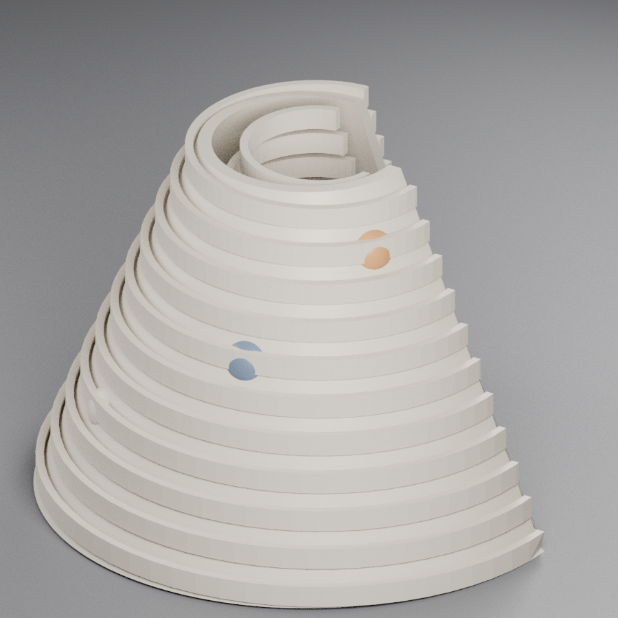

# 旋涡 / VORTEX

> 2.4 米的轨道，塞进 70 毫米的漏斗。



| 尺寸 | 圈数 | 轨道长 | 打印 | 支撑 | 件数 |
|---|---|---|---|---|---|
| Ø100 × 70 mm | 11 | **≈2.4 m** | ~5 h | **无** | 3 类（漏斗 / 珠 / 托盘） |

---

## 这是什么

一个空心漏斗，内壁长着两条**螺旋护栏**（11 圈）。珠子从顶部的投珠孔落进去，卡在两条护栏之间，沿着漏斗内壁螺旋下滑——

一圈、两圈、三圈……越转越快，**11 圈之后从底部掉出来，落进托盘**。

没有电机，没有磁铁，没有弹簧。它只做一件事：把重力变成旋转。

---

## 关于"硬币收集器"

商场里的硬币收集器是一个漏斗，硬币沿内壁螺旋下降，转很多圈才掉进洞里。这个玩具是它的 3D 打印版，但改了一个关键结构：

**不是让珠子在光面上滑，而是让它卡在两条螺旋护栏之间滚。**

原因：

- 光面上的珠子会"走直线"——它不会自己螺旋，只会沿最陡方向（径向）滑下去；
- 两条护栏把"螺旋"变成了**几何约束**，珠子只能沿护栏走；
- 护栏还能挡住离心力——珠子转得越快，越贴外护栏，但翻不出去（除非快到离谱）。

---

## 为什么是"护栏"不是"刻槽"

第一版想在锥面上**刻**一条 V 槽（像唱片纹路那样）。问题是：

- 锥面 + 螺旋槽的网格，必须沿螺旋方向高密度采样，否则槽在网格上会"断成虚线"；
- 用 CAD 布尔可以精确做，但 11 圈 × 720 段的扫掠在 cadquery 里非常慢。

改成**两条凸起的护栏**之后：

- 每条护栏就是一个矩形截面沿螺旋路径扫掠，网格 5760 面，秒级生成；
- 护栏是竖直的薄墙，**免支撑**；
- 护栏的高度（3.5 mm）可以独立于漏斗壁厚（2.5 mm）调节——这比"槽深"自由得多。

**同一个功能，换一种几何，从"难打印"变成"免支撑"。**

---

## 玩法

1. **投珠**：把珠子从顶部孔丢进去，看它转 11 圈。
2. **比赛**：3 颗珠子同时投，看谁先到底。
3. **能转到底吗**：投得越"斜"、珠子越快，离心力越大，越可能翻出护栏——掉进托盘也算"到站"。
4. **听**：珠子越转越快，护栏接缝处的"嗒嗒"声越来越密，最后"啪"地落盘。

---

## 打印

```bash
stl/vortex_funnel.stl     # 漏斗 + 双螺旋护栏（Ø100 × 70）
stl/vortex_bead.stl       # 珠子 Ø10（打印 3 个，或用 10 mm 钢珠）
stl/vortex_plate.stl      # 托盘（Ø130 × 8）
```

- **材料**：PLA 或 PETG
- **层高 / 喷嘴**：0.2 mm / 0.4 mm
- **壁 / 填充**：3 墙 / 15%
- **支撑**：**关闭**
- **摆放**：漏斗大口朝下（底环贴床），托盘平放，珠子正常

**装配**：珠子从顶部孔投入即可。托盘放在漏斗下面接珠。

详细设置与调校见 [docs/print-guide.md](docs/print-guide.md)。

---

## 为什么它"不是没用"

前两版（[触感唱片](https://github.com/super-cup/tactile-record)、[潮汐](https://github.com/super-cup/tide)）都需要**你持续操作**：转、倾斜。停下来，它就停了。

这一版不同：**你只需要投一颗珠子，剩下的交给重力。** 它会自己转 11 圈，自己加速，自己结束。

这是一个"放手"的玩具——你付出的只有一次投掷，它回报你一段完整的、有开始和结束的运动。

---

## 参数

| 参数 | 默认 | 改动效果 |
|---|---|---|
| `TURNS` | 11 | 圈数。越多越长，但护栏会越来越密（受 `H` 限制） |
| `H` | 70 | 漏斗高度。圈数 × 螺距 ≤ H |
| `R_BOT` | 50 | 底部越大，锥面越缓，珠子越慢 |
| `RAIL_GAP` | 10 | 两条护栏中心距。珠子 Ø10 → 内净宽 8 |
| `RAIL_H` | 3.5 | 护栏高度。太低珠子会翻出 |
| `WALL` | 2.5 | 漏斗壁厚。必须大于护栏嵌入深度 |

---

## 许可

- **模型与文档**：[CC BY-NC-SA 4.0](LICENSE)
- **脚本**：[MIT](LICENSE-CODE)

---

*2026-11 · 尺寸单位 mm · 全部几何由 numpy 参数化生成*
